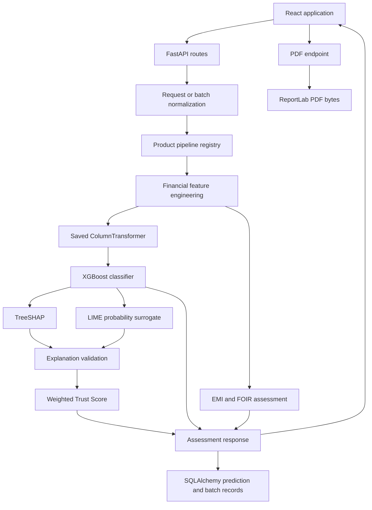

# TrustFin AI — repository analysis and rebuild guide

Reviewed on 17 November 2026 against Git revision `7604d99`, local artifacts, and concurrent uncommitted application changes observed during the review.

This document captures the existing project, its implementation details, its conflicting historical state, and a proposed route to a fresh implementation. It is intended to travel with the source when starting a new repository. The rebuild steps below are proposals for future work. This documentation task changed the two README files only.

Application source and tests changed externally during this task. The guide was refreshed against those files, including revised metric functions, three-component aggregation, dynamic weight presentation and added tests. Earlier checks are identified as initial results. These observations describe a changing working tree, so the Git revision alone cannot recreate the reviewed state.

## Contents

- [Project purpose](#project-purpose)
- [Rebuild assessment](#rebuild-assessment)
- [Verified repository state](#verified-repository-state)
- [Architecture and execution flow](#architecture-and-execution-flow)
- [Backend module map](#backend-module-map)
- [Application inputs and API](#application-inputs-and-api)
- [Datasets and label generation](#datasets-and-label-generation)
- [Feature engineering and training](#feature-engineering-and-training)
- [Model artifacts and reproducibility](#model-artifacts-and-reproducibility)
- [SHAP and LIME](#shap-and-lime)
- [Implemented validation formulas](#implemented-validation-formulas)
- [Persistence and history](#persistence-and-history)
- [Frontend and user journeys](#frontend-and-user-journeys)
- [PDF reporting](#pdf-reporting)
- [Running the existing application](#running-the-existing-application)
- [Scripts and supporting material](#scripts-and-supporting-material)
- [Verification results](#verification-results)
- [Defects to address during rebuilding](#defects-to-address-during-rebuilding)
- [Retained decisions and research context](#retained-decisions-and-research-context)
- [Proposed clean project](#proposed-clean-project)
- [Staged rebuild and acceptance criteria](#staged-rebuild-and-acceptance-criteria)
- [Handoff brief for the new project](#handoff-brief-for-the-new-project)
- [Complete tracked-file inventory](#complete-tracked-file-inventory)

## Project purpose

TrustFin AI is a final-year academic project investigating explanation reliability in loan-approval decision support. Its main research question is how to evaluate local model explanations before presenting them to an officer or applicant.

The application supports residential home loans and personal loans. A third legacy pipeline remains available for older inputs and tests. Each assessment combines an XGBoost prediction, financial affordability calculations, SHAP and LIME feature contributions, four experimental validation components, and a weighted Trust Score. Results can be viewed, stored, retrieved, batch-processed, and exported as PDFs.

The current supervised target is `Loan_Status`, with `Approved` mapped to 1 and `Rejected` mapped to 0. The product datasets use authored synthetic underwriting labels. Their probabilities describe the approval class under those labels. The repository provides no observed repayment-outcome evaluation or calibration experiment.

### Implemented capabilities

| Area | Existing capability |
|---|---|
| Products | Separate home-loan and personal-loan models, plus legacy compatibility |
| Intake | Product-specific form, preset individual profiles, CSV upload, JSON batch submission |
| Financial calculations | EMI, existing obligations, income, FOIR/DTI, surplus, and home-loan LTV |
| Prediction | Binary classification, approval probability, predicted-class probability |
| Explanations | Local TreeSHAP and tabular LIME through a shared feature-contribution schema |
| Validation | Faithfulness, stability, cross-explainer consistency, Gender sensitivity |
| Presentation | Officer summary, detailed audit, applicant assessment, submitted-form modal |
| Records | Individual history, batch history, detail retrieval and deletion |
| Reporting | ReportLab assessment PDF, preview, download and browser printing |
| Scenario exploration | Browser-side affordability calculator |
| Academic material | Papers, presentation specification, nine-chapter LaTeX report, diagrams and screenshots |

## Rebuild assessment

A fresh implementation is reasonable. The existing stack suits the project, and several reusable ideas already work. The main difficulties come from overlapping versions, coupled route logic, incomplete artifact packaging, inconsistent contracts, and research claims that outgrew their implementation.

Use the existing repository as an inspected reference and historical record. Build the new application around a small reproducible assessment pipeline, carrying forward verified behavior and selected assets. A rewrite that copies the current data/model/metric assumptions wholesale would reproduce the same defects.

### Parts worth carrying forward

- Product-specific financial feature engineering and training-only preprocessing fits.
- The shared explanation representation, extended with units, references and diagnostics.
- Complete historical response snapshots and explicit UTC serialization.
- Invalid-row feedback during batch intake.
- The officer/applicant screen split and submitted-application view.
- Current assessment-oriented PDF wording and its focused regression tests.
- Existing test scenarios, updated to an agreed contract.
- Research findings, protocols and diagrams with their original context preserved.

### Proposed simplifications

- One assessment service used by individual requests, batches and scenario re-evaluation.
- One explicit input-validation and normalization contract per product.
- One authoritative product configuration for rates, feature definitions and project thresholds.
- One coherent artifact bundle per training run.
- One active dashboard implementation.
- A concise current specification and decision log alongside archived research deliverables.

The proposed structure later in this document retains React, FastAPI, scikit-learn/XGBoost, SHAP, LIME, SQLAlchemy and ReportLab. PostgreSQL remains the documented architectural database choice. Local SQLite support can remain an explicit development option.

## Verified repository state

The initial worktree was clean. Git tracked 197 files, and every tracked file existed locally. Important additional model files and research outputs were present under ignored paths.

### Critical source/artifact disagreement

The local product `model.pkl` and `preprocessor.pkl` files match the hashes in retained v4 provenance. The checked-in generators, training CSVs, metrics and execution code describe an earlier state. Both product `background_data.npy` files differ from their v4 provenance hashes. The provenance's original training CSV hashes also differ from the current CSV hashes.

| Item | Observed state |
|---|---|
| Current generators | Include a deliberate female label penalty near the synthetic decision boundary |
| Current product CSVs | Match the current default generators numerically |
| Local product weights and preprocessors | Match retained Gender-included v4 provenance |
| Local provenance's training data | Different hashes from current training CSVs |
| Local LIME backgrounds | Different hashes from retained v4 background hashes |
| Product feature-name lists | Match retained v4 provenance and model dimensions |
| Saved product metrics | Older records reporting 97.00% and 97.33% accuracy |
| API model versions | Hardcoded `home_loan_v2` and `personal_loan_v2` |
| Faithfulness source | Concurrent revision uses relative predicted-class probability drop after top-five SHAP masking |
| Composite source | Concurrent revision weights faithfulness/stability/consistency 40/30/30 and carries fairness separately |
| Faithfulness protocol document | Describes a later approved held-out LIME-fidelity design |
| Historical implementation plan | Describes files and tests absent from current source |

The inspected v4 provenance names `home_loan_v4-04190fb76be9` and `personal_loan_v4-8eecbbbf9e25`. Its selected Gender-included models were trained against corrected labels. Reusing those weights with the current earlier datasets/backgrounds creates a mixed experiment state.

Applying the local weights and preprocessors to the current CSVs' stratified seed-42 20% split produced these compatibility diagnostics.

| Product | Saved accuracy | Diagnostic accuracy | Diagnostic ROC-AUC |
|---|---:|---:|---:|
| Home | 0.970000 | 0.871667 | 0.914444 |
| Personal | 0.973333 | 0.945000 | 0.985985 |

These diagnostics use current CSV labels with historically different model weights. Their split has no verified holdout relationship to the v4 training data. Establish a new documented training/evaluation baseline during rebuilding.

### Availability in a fresh clone

Git tracks the legacy weights. The four product weight/preprocessor files are ignored by `*.pkl`, and product provenance is explicitly ignored. A clone therefore lacks the product weights available on this computer. Registry fallback may then score requests with another available model.

Locally retained research and recovery paths include `experiments/`, `models/experiments/`, `scratch/model_backups/`, and `scratch/reset_backup_20261116T213401Z/`. Their contents need an explicit preservation decision when transferring the project.

## Architecture and execution flow



### Individual assessment sequence

1. `LoanApplicationRequest` accepts the payload.
2. `evaluate_single_record` determines a requested product and obtains its pipeline.
3. `ModelRegistry.normalize_input` fills/coerces fields and bridges legacy credit history.
4. The product feature function computes financial features.
5. The saved preprocessor transforms the enriched row.
6. Financial calculations assign an affordability band.
7. XGBoost produces its class and approval probability.
8. SHAP and LIME generate approval-oriented explanations.
9. The route computes four diagnostics and weights faithfulness, stability and consistency in the aggregate.
10. The route builds the response and database field dictionary.
11. `/predict` attempts to persist a prediction snapshot and attaches its database ID.

The affordability band and model prediction are separately returned. The current route returns the model class even when the affordability band is `INSOLVENT`. The active UI supplies review guidance for this combination.

### Registry behavior

The registry loads product artifacts at module import, using relative paths under `models/`. It creates reusable model/preprocessor/explainer objects. It also loads the legacy model and builds its LIME background from the processed CSV.

The registry's default is home loan when available, otherwise legacy. String matching accepts several informal product spellings. Unknown or missing pipelines fall back to home or legacy. The route has additional selection logic for requests without `loan_type` and checks a separately loaded legacy global model before processing. Legacy weights/explainers are consequently initialized twice.

## Backend module map

All application paths below are relative to `backend/app/`.

| Module | Responsibility |
|---|---|
| `main.py` | FastAPI construction, database startup, validation-error handler, CORS, health endpoint, route inclusion |
| `api/schemas.py` | Single-application, prediction, solvency, history, PDF and batch Pydantic contracts |
| `api/routes/prediction.py` | Product routing, row validation, evaluation orchestration, persistence, all loan/history/batch/PDF endpoints and presets |
| `ml/registry.py` | `ProductPipeline`, `ModelRegistry`, loading and input normalization |
| `ml/preprocessing.py` | Legacy financial features and ColumnTransformer |
| `ml/preprocessing_homeloan.py` | Home-loan financial features and ColumnTransformer |
| `ml/preprocessing_personalloan.py` | Personal-loan financial features and ColumnTransformer |
| `explainability/schemas.py` | `FeatureContribution` and `StandardExplanation` |
| `explainability/shap_explainer.py` | SHAP wrapper and feature-contribution serialization |
| `explainability/lime_explainer.py` | LIME wrapper, mutable seed configuration and serialization |
| `validation/faithfulness.py` | Relative predicted-class probability drop after top-five SHAP coordinate masking |
| `validation/stability.py` | Absolute-importance rank comparison and directional agreement |
| `validation/consistency.py` | Top-five Jaccard overlap and shared-feature directional agreement |
| `validation/fairness.py` | Individual Gender sensitivity and an auxiliary equal-opportunity-ratio helper |
| `trust/trust_score.py` | Weighted aggregation and `TrustEvaluation` |
| `db/models.py` | `PredictionLog` and `BatchUpload` tables |
| `db/session.py` | Environment loading, engines, sessions, fallback, table creation and additive schema changes |
| `reporting/pdf_generator.py` | A4 assessment PDF generation |

The route file combines several responsibilities and is a major target for decomposition during rebuilding.

## Application inputs and API

Money is represented in rupees, income/obligations are monthly, tenure is in months, and utilization is ordinarily a 0–1 ratio. Product IDs are `home_loan` and `personal_loan`. The table describes the current single-request schema defaults. Normalization can subsequently supply additional values.

| Field | Type / default | Meaning |
|---|---|---|
| `loan_type` | Optional string / `None` | Requested product |
| `Gender` | String / `Male` | Current datasets use Male/Female |
| `Married` | String / `No` | Yes/No |
| `Dependents` | Optional integer / 0 | Dependent count |
| `Education` | String / `Graduate` | Graduate/Not Graduate |
| `Employment_Status` | String / `Salaried` | Salaried/Self-Employed/Unemployed |
| `Applicant_Income` | Required float | Applicant monthly income |
| `Coapplicant_Income` | Optional float / 0 | Used for home-loan household income |
| `Loan_Amount` | Required float | Principal |
| `Loan_Term` | Required integer | Months |
| `Credit_History` | Optional integer / `None` | Legacy 0/1 credit indicator |
| `Property_Area` | Optional string / `Urban` | Urban/Semiurban/Rural |
| `Age` | Float / 30 | Years |
| `CIBIL_Score` | Optional integer / `None` | Intended bureau-score range 300–900 |
| `Missed_Payments_12M` | Optional integer / `None` | Recent delinquency count |
| `Existing_EMI` | Optional float / 0 | Existing monthly obligations |
| `Work_Experience` | Optional integer / `None` | Years |
| `Property_Value` | Optional float / `None` | Home-loan collateral valuation |
| `Loan_Purpose` | Optional string / `None` | Personal-loan purpose |
| `Credit_Card_Utilization` | Optional float / `None` | Personal-loan revolving utilization |

### Current normalization details

- Legacy credit history maps to CIBIL 750 or 480 when a score is absent. With neither input, the registry uses 720.
- Missing work experience can be derived as `max(1, Age - 22)` in the registry. The form supplies five years for a numeric zero through its `|| 5` expression.
- Missing delinquency counts can be inferred from CIBIL in the registry. Single-request Pydantic defaults and batch defaults can instead supply zero.
- Missing/nonpositive property value becomes `Loan_Amount / 0.75`.
- Utilization values above 1 through 100 are converted to fractions by the request validator. Out-of-range values are clamped. Malformed values can become zero.
- Invalid optional numeric strings can become zero, and an invalid CIBIL string can become 720.
- Most single-request numeric fields have no bounds, and categories/product IDs use unrestricted strings.
- Batch intake has separate validation, aliases and bounds, including positive income/principal, age 18–100, score 300–900 and nonnegative existing debt. It still requires finite-number checks and a unified contract.

These coercions need explicit redesign to preserve original submissions and distinguish declared values from assumptions.

### Endpoint catalog

Loan endpoints share the prefix `/api/v1/loan`.

| Method | Path | Request / response |
|---|---|---|
| GET | `/health` | Static `{"status":"healthy"}` outside the loan prefix |
| POST | `/predict` | `LoanApplicationRequest` → `LoanPredictionResponse` |
| POST | `/predict-batch` | Multipart `file`, optional `loan_type` → `BatchUploadResponse` |
| POST | `/predict-batch-json` | `{filename?, loan_type?, rows}` → `BatchUploadResponse` |
| GET | `/batch-sample-csv` | Optional `loan_type`, defaults home → CSV download |
| GET | `/batch-presets/{preset_id}` | `home_loan` or `personal_loan` → named demo rows |
| GET | `/evaluations` | Optional `limit=50` → evaluation summaries |
| GET | `/evaluations/{evaluation_id}` | Integer database ID → input and full saved result |
| DELETE | `/evaluations/{evaluation_id}` | Deletes one evaluation |
| GET | `/batches` | Optional `limit=50` → batch summaries |
| GET | `/batches/{batch_id}` | Batch reference → flawed rows and child summaries |
| DELETE | `/batches/{batch_id}` | Deletes batch and linked predictions |
| POST | `/generate-pdf` | `{applicantData, predictionResult}` → PDF bytes |

FastAPI exposes generated API documentation at `/docs`, `/redoc` and `/openapi.json`.

### Response contract

`LoanPredictionResponse` contains the following fields.

| Field | Meaning |
|---|---|
| `prediction` | Model class string, Approved or Rejected |
| `probability` | `predict_proba(x)[1]`, approval-class probability |
| `confidenceScore` | Approval probability for an approval, otherwise `1 - probability` |
| `modelVersion` | Hardcoded version string for the chosen pipeline |
| `shap`, `lime` | `StandardExplanation` objects |
| `trustScore` | Four components plus `overallTrustScore` |
| `solvencyCheck` | EMI, debt, income, FOIR/DTI, surplus, band, boolean and warning |
| `evaluationId` | Nullable database integer ID |
| `dossierId` | Generated product/application reference |

`StandardExplanation` has `method` and `features`. Each feature contains `feature`, numeric `value`, numeric `contribution`, and `direction` in positive/negative/neutral. The current schema omits raw category values, output units, explained class, reference/base value, fit diagnostics and protocol versions.

`SolvencyCheckResult` fields are `monthlyEMI`, `existingEMI`, `totalMonthlyObligation`, `netDisposableIncome`, `totalIncome`, `dtiRatio`, `dtiPercent`, `status`, `isSolvent` and `overrideWarning`.

`TrustEvaluation` fields are `faithfulness`, `stability`, `consistency`, optional `fairness`, `overallTrustScore`, and optional `weights`. The three weighted components require numeric values. Fairness is carried as a separate diagnostic.

Batch responses include `batchId`, `filename`, `timestamp`, `totalRecords`, `validRecords`, `flawedRecords`, `flawedData`, `processedResults` and `summary`. Flawed rows retain their row number, raw data and error reason. Summary contains approval/rejection counts and average trust.

### Example home-loan request

This is a synthetic input example. Numerical assessment results must come from the running pipeline.

```json
{
  "loan_type": "home_loan",
  "Gender": "Female",
  "Married": "Yes",
  "Dependents": 1,
  "Education": "Graduate",
  "Employment_Status": "Salaried",
  "Age": 35,
  "Work_Experience": 10,
  "Applicant_Income": 80000,
  "Coapplicant_Income": 20000,
  "Existing_EMI": 6000,
  "Loan_Amount": 3500000,
  "Loan_Term": 240,
  "Property_Value": 5000000,
  "Property_Area": "Urban",
  "CIBIL_Score": 810,
  "Missed_Payments_12M": 0
}
```

For a personal loan, use `personal_loan`, supply `Loan_Purpose` and `Credit_Card_Utilization`, and use applicant income for FOIR. Example purposes are `Medical_Emergency`, `Education`, `Home_Renovation`, `Wedding`, `Travel` and `Debt_Consolidation`.

## Datasets and label generation

### Current files

| File | Rows | Columns | Approved | Rejected | Role |
|---|---:|---:|---:|---:|---|
| `datasets/train.csv` | 3,192 | 14 | 1,596 | 1,596 | Legacy input data |
| `data/processed/train_clean.csv` | 2,998 | 16 | 1,437 | 1,561 | Legacy cleaned/augmented data and runtime LIME background source |
| `datasets/homeloan_train.csv` | 3,000 | 18 | 1,529 | 1,471 | Current home synthetic dataset |
| `datasets/personalloan_train.csv` | 3,000 | 17 | 1,563 | 1,437 | Current personal synthetic dataset |

The legacy CSV has no verified external dataset provenance or licensing record in the inspected project. Its columns include applicant demographics, income, principal, tenure, legacy credit history, area, age, ID and label.

Both product generators default to 3,000 records and seed 42. They generate demographics, financial inputs and bureau variables, compute a latent score, apply explicit overrides, and write deterministic labels. There is an intentional `-0.65` female adjustment when the unadjusted latent score has absolute value below 1.0. This is present in the current source despite later neutral-label decisions retained in documentation.

### Home-loan generator

- Age is 23–57, employment is Salaried/Self-Employed, and household income can include a co-applicant.
- Applicant monthly income is clipped to 20,000–350,000 rupees.
- Candidate tenures are 60, 120, 180, 240, 300 and 360 months, constrained by maturity at age 65.
- Principal is clipped to 300,000–10,000,000 rupees. Property values are generated from a target LTV distribution.
- CIBIL and delinquencies are correlated. EMI uses annual interest 8.5%.

The current latent formula is recorded here to permit a faithful reconstruction of the existing generator.

```text
z = 0.05
  + 2.3 * (CIBIL - 690) / 100
  - 3.8 * (FOIR - 0.45)
  - 0.08 * (LTV_percent - 75)
  - 1.2 * missed_payments
  + 0.4 * log(total_income / 65000)
  + 0.25 * graduate_indicator
  + 0.20 * salaried_indicator
  + 0.15 * nonrural_indicator
```

After the Gender adjustment, `sigmoid(z) >= 0.5` yields Approved. Hard rejection applies for CIBIL below 560, at least three missed payments, FOIR above 0.68, or LTV above 92%. A hard approval applies for CIBIL at least 770, FOIR at most 0.40, LTV at most 78%, and zero missed payments. In the source, the hard-approval assignment runs after hard rejection.

### Personal-loan generator

- Age is 21–57 and applicant monthly income is clipped to 18,000–250,000 rupees.
- Tenures are 6, 12, 24, 36, 48 and 60 months.
- Principal is clipped to 30,000–1,000,000 rupees.
- Utilization is generated in approximately the 0.05–0.95 range.
- EMI uses annual interest 13.5%. The product has purpose-specific score terms.

```text
z = -0.18
  + 2.5 * (CIBIL - 695) / 100
  - 4.5 * (FOIR - 0.42)
  - 2.0 * (utilization - 0.40)
  - 1.4 * missed_payments
  + 0.4 * log(applicant_income / 48000)
  + 0.30 * graduate_indicator
  + 0.25 * salaried_indicator
  + 0.30 * clip(work_experience / 8, 0, 1)
  + purpose_score
```

Purpose scores are 0.35 medical, 0.25 education, 0.10 renovation, 0 wedding, -0.25 travel and -0.40 debt consolidation. After the Gender adjustment and probability threshold, hard rejection applies for CIBIL below 580, at least three missed payments, FOIR above 0.60, utilization above 0.88, or income below 19,000 rupees.

The generator rejection thresholds differ from the application's 50% affordability review threshold. Treat all these values as versioned project assumptions when rebuilding. Any claims concerning specific lending regulations need a separately established source and scope.

## Feature engineering and training

### Financial formulas

For principal `P`, monthly rate `r = annual_rate / 12`, and tenure `n` months, product EMI is computed as follows.

```text
EMI = P * r * (1 + r)^n / ((1 + r)^n - 1)
Home total_income = applicant_income + coapplicant_income
Home FOIR = (existing_EMI + proposed_EMI) / total_income
Home LTV_percent = 100 * principal / property_value
Personal FOIR = (existing_EMI + proposed_EMI) / applicant_income
```

Product EMI is rounded to two decimals, FOIR to four decimals, and LTV to two decimals. Zero denominators/tenures are replaced with 1 in feature functions. Strict intake validation is preferable to interpreting invalid financial values this way in the rebuild.

Legacy engineering uses `principal / months` for EMI and proposed EMI divided by household income for DTI. Existing debt and interest are absent from its DTI formula. The runtime legacy response can consequently have debt totals whose ratio uses different components.

Affordability bands are `OPTIMAL` at ratio ≤0.35, `MODERATE` above 0.35 through 0.50, and `INSOLVENT` above 0.50. `isSolvent` is true through 0.50. The API's current warning strings still use regulatory terminology for the configured ceiling.

### Product feature sets

Both product preprocessors one-hot encode categorical fields with `drop='first'`, `handle_unknown='ignore'`, and dense output, then standard-scale numerical fields. Their numerical pipelines contain no imputers.

| Product | Categorical fields | Numerical fields |
|---|---|---|
| Home | Gender, Married, Education, Employment_Status, Property_Area | Age, Dependents, Work_Experience, Applicant_Income, Coapplicant_Income, Existing_EMI, Loan_Amount, Loan_Term, Property_Value, CIBIL_Score, Missed_Payments_12M, Monthly_EMI, FOIR, LTV_Ratio |
| Personal | Gender, Married, Education, Employment_Status, Loan_Purpose | Age, Dependents, Work_Experience, Applicant_Income, Existing_EMI, Loan_Amount, Loan_Term, Credit_Card_Utilization, CIBIL_Score, Missed_Payments_12M, Monthly_EMI, FOIR |

Current feature lists have 20 transformed home features and 21 personal features. Home `Total_Income` is computed as an intermediate and excluded from the ColumnTransformer output. Saved feature order is categorical indicators followed by numerical columns. Legacy output order is numerical columns, categorical indicators and passthrough `Credit_History`, yielding 16 features.

### Product trainers

`scripts/train_homeloan.py` and `scripts/train_personalloan.py` drop ID/target, map approval to 1, split 80/20 using seed 42 and stratification, fit the preprocessor on training rows, then train XGBoost.

```text
n_estimators = 120
max_depth = 4
learning_rate = 0.08
subsample = 0.85
colsample_bytree = 0.85
random_state = 42
eval_metric = logloss
```

They calculate accuracy, precision, recall, F1, ROC-AUC, print a classification report and Gender approval-rate ratio, and export artifacts. Product metrics omit the confusion matrix, split indices, calibration, source/data hashes, package versions and comparative baselines in the current trainer implementation. The retained v4 provenance came from a later training implementation whose helper files are absent.

### Legacy trainer

`scripts/train_model.py` drops rows containing missing values, adds financial features, and attempts 150 seed-42 synthetic boundary draws. It appends qualifying high-DTI examples with good credit history and a Rejected label before splitting. The resulting processed file currently has 2,998 rows. Its model uses XGBoost defaults plus seed 42 and logloss evaluation.

It exports classification metrics, confusion matrix, Gender TPRs, equal-opportunity and approval-rate ratios, feature configuration and a timestamped log. Its augmentation/split composition needs separate reporting when establishing evaluation claims.

## Model artifacts and reproducibility

### Expected artifact bundles

Each product registry expects `model.pkl`, `preprocessor.pkl`, `feature_names.json`, `metrics.json`, and `background_data.npy` under `models/homeloan/` or `models/personalloan/`. Background arrays contain the first 100 transformed training rows exported by the current trainers.

The legacy pipeline requires `models/loan_prediction_model.pkl`, `models/preprocessor.pkl`, `models/feature_config.json`, and `data/processed/train_clean.csv`. `models/model_metadata.json` contains its saved evaluation record. The registry instead assigns legacy accuracy a hardcoded 0.82 in memory.

### Saved metric records

These values are read from current JSON files. The product rows are historical metadata with the compatibility mismatch described above.

| Pipeline | Accuracy | Precision | Recall | F1 | ROC-AUC |
|---|---:|---:|---:|---:|---:|
| Home | 0.970000 | 0.961538 | 0.980392 | 0.970874 | 0.997810 |
| Personal | 0.973333 | 0.974441 | 0.974441 | 0.974441 | 0.996338 |
| Legacy | 0.991667 | 0.986254 | 0.996528 | 0.991364 | 0.999677 |

Saved product female/male approval-rate ratios are approximately 0.905840 home and 0.864819 personal. The legacy saved confusion matrix is TN 308, FP 4, FN 1, TP 287. These records need their matching datasets, artifacts and evaluation protocol for interpretation.

### Local artifact fingerprints

```text
models/homeloan/model.pkl
e084d5cb62e1aad43c8b3edf1e26abc81aa5deddd9c45d988e303cae2f73b797

models/homeloan/preprocessor.pkl
cda8fd141d097f7bbf1eeb4b3fceb05a128825ac10556fdee75833ef4ece3034

models/personalloan/model.pkl
b101b3a60666989cc612475b066988cd545afc788d377220331b4aa627056dd9

models/personalloan/preprocessor.pkl
b59270f7c5419540faee4b93b7543bed7c7489f69be4ab2a0a60c69b13c419b8

datasets/homeloan_train.csv
617d65461285c3cc9db9057e094dbb952c284ee122fbc3d90a908ada21c0d8f5

datasets/personalloan_train.csv
42f54e80742d6ea0f98a43f50d0000acbf91cea0c028053b0141f5946eeb01c5

datasets/train.csv
771a6ec1f738478a11fad2cbe6277aa87913ccc6a7f54dcc38de5a9dea1ae504

data/processed/train_clean.csv
2044ba02e3cf439c24d642eb78921f04cea5e51f4d9292cf90cca52dc8d9d3b7
```

Both retained provenance files reference absent `model.ubj`, `background_raw.csv` and `split_indices.json` files. Product background arrays have shapes `(100,20)` and `(100,21)`, but their values differ from the provenance hashes. File presence and matching dimensions alone are insufficient to establish bundle coherence.

A new run should identify model, dataset, feature configuration, preprocessor, explanation configuration, metric protocol, seed and dependency versions together. Persist that identity with each assessment. Native model export can complement a version-matched serialized preprocessing object.

## SHAP and LIME

### SHAP wrapper

`SHAPExplainer` constructs `shap.TreeExplainer(model)` without explicit reference data or output configuration. For the binary XGBoost pipelines inspected here, contributions explain the approval raw margin in log-odds using the implicit tree-path reference. The exported background arrays are consumed by LIME.

The wrapper handles array/list return variants, emits every transformed feature, and assigns direction using thresholds ±0.0001. Numeric raw values replace transformed values only where the supplied dictionary key exactly matches the transformed feature name. Categorical indicators usually remain transformed numeric values.

The response omits SHAP's expected value, so clients cannot reconstruct the full decomposition from the public schema alone. There is no active cohort-level global SHAP aggregation endpoint.

### LIME wrapper

`LIMEExplainer` initializes `LimeTabularExplainer` on transformed background rows in classification mode, with Rejected/Approved class names and baseline seed 42. The call requests all features. It leaves sample count, kernel and discretization at library defaults. In the installed LIME version the default draw count is 5,000.

It explains class 1 via `predict_proba`, reads `as_map()[1]`, and assigns direction with the same threshold as SHAP. LIME coefficients describe the fitted local probability surrogate and its discretized conditions. The wrapper discards condition descriptions, intercept, local prediction and fit score.

Request seeding mutates the shared LIME object's random state, its base/discretizer states, and NumPy's process-global seed. Concurrent calls therefore need isolated random-state handling in the rebuild. Sampling transformed coordinates can generate invalid categorical combinations and inconsistent derived financial features.

### Interpretation requirements for the rebuild

Record the explained class, output units, reference semantics, feature representation, original values and method-specific diagnostics. Keep SHAP and LIME magnitudes in their respective scales. Positive contribution currently means increased support for approval even when the predicted class is Rejected.

## Implemented validation formulas

This section documents the latest executable formulas inspected after concurrent edits. Research protocols elsewhere in the repository describe additional historical or proposed designs. Numerical ranges and repeatability alone provide limited evidence about explanation quality. The documentation task did not select or implement these formula changes.

### Faithfulness

The current function evaluates SHAP. It selects the five largest absolute finite contributions whose names exist in the model feature list, masks those transformed coordinates to zero or supplied baselines, and measures the change in the original predicted-class probability. It validates a one-row input, feature width and positive `top_k`. An empty selected set returns zero.

```text
original_target = approval_probability if original_class == 1
                  else 1 - approval_probability
masked_target = masked_approval_probability if original_class == 1
                else 1 - masked_approval_probability
faithfulness = clip((original_target - masked_target)
                    / max(original_target, 1e-8), 0, 1)
```

This measures a relative probability drop under coordinate masking. Ranking uses absolute contribution, so selected features can include opposing-class evidence. Masking individual transformed coordinates can break one-hot and financial dependencies. The held-out LIME protocol retained in the documentation specifies a different measurement.

### Stability

The route still generates one transformed neighbor using Gaussian noise with standard deviation 0.01 and a request-derived seed. The revised function aligns finite contributions over the union of feature names, fills absent contributions with zero, ranks absolute magnitudes and computes a nonnegative Spearman rank score.

```text
rank_score = clip(Spearman(absolute_importance_ranks), 0, 1)
direction_score = mean matching nonzero contribution signs
stability = clip(0.70 * rank_score + 0.30 * direction_score, 0, 1)
```

Direction comparison selects up to five coordinates by the larger absolute contribution across the two explanations, then compares coordinates nonzero in both. With no directional evidence it returns zero for that term. For undefined correlation, identical rank arrays receive rank score one. An empty feature union returns zero. One-feature rank handling checks whether contribution values are close.

The route still perturbs encoded categories and derived coordinates, and evaluates one neighbor. Repeated domain-valid neighborhoods, prediction-change reporting and uncertainty remain open research work.

### Consistency

Take the five largest absolute finite contributions from each method. Compute Jaccard overlap and sign agreement among shared features with nonzero contributions in both methods.

```text
jaccard = size(SHAP_top5 intersection LIME_top5)
          / size(SHAP_top5 union LIME_top5)
direction_agreement = mean matching signs among shared nonzero features
consistency = clip(0.60 * jaccard + 0.40 * direction_agreement, 0, 1)
```

Empty unions and absent shared directional evidence contribute zero to their respective terms. Matching feature sets with entirely reversed signs still score 0.60 through the overlap term. The frontend also computes a separate displayed sign-agreement summary over its selected comparison rows.

### Fairness component

The per-applicant component changes Gender between Male and Female, recomputes product features, and compares approval probabilities.

```text
fairness_component = clip(1 - abs(p_original - p_gender_changed), 0, 1)
missing/unsupported Gender, missing engineered columns,
nonfinite model probabilities or an exception -> 0.0
```

This is a direct protected-attribute probability-sensitivity check. Decision flips near the class boundary, cohort outcomes, causal assumptions and explanation-quality disparities require additional measures. Failure currently shares numeric zero with a measured large sensitivity, so an explicit availability/error field remains desirable.

The auxiliary equal-opportunity function checks equal input lengths, filters missing group values and compares group TPRs among approved-label rows. Empty/insufficient eligible groups and maximum TPR zero return zero. Handled type/value/key errors return zero. The prediction route uses the individual sensitivity function.

### Composite score

```text
TrustScore = 0.40 * faithfulness
           + 0.30 * stability
           + 0.30 * consistency
```

Fairness is carried in the response as a separate audit value. The returned `weights` dictionary records the aggregate configuration. Caller-provided weights must contain exactly the three weighted keys, be finite/nonnegative and sum to one. Input component range/finite validation still needs its own contract.

Database rating thresholds remain high at ≥0.85, moderate at ≥0.70, and low below 0.70. The public `TrustEvaluation` omits the persisted rating. Historical snapshots without `weights` remain loadable, and current presentation reports that their weighting was unrecorded.

This is a project-defined weighted index. Weight/threshold changes, unavailable-value behavior and scientific interpretations need explicit owner decisions under the repository's validation rules.

### Initial checked-in metric state

At the beginning of this review, faithfulness selected class-supporting SHAP features, measured an absolute zero-mask probability change relative to a zero-vector reference, and mapped most nontrivial ratios into `0.74 + 0.17 * (1 - exp(-ratio))`. Stability rescaled signed Spearman correlation with `(rho + 1) / 2`. Consistency used unsigned top-three Jaccard. Fairness exceptions returned one. The aggregate weights were 35% faithfulness, 25% stability, 30% consistency and 10% fairness. These are the earlier formulas still referenced in several retained documents and snapshots.

### Deterministic seeding

`generate_applicant_seed` hashes sorted request JSON with SHA-256, takes the first eight hex digits and reduces modulo `2^31 - 1`. It has special handling for legacy core keys. Null values are removed first. Unused submitted fields can still change product explanation seeds, so canonical predictive-input seeding is a rebuild concern.

## Persistence and history

### Tables

| Table | Stored fields |
|---|---|
| `prediction_logs` | Integer ID, unique dossier reference, timestamp, product, CIBIL, age, income, principal, normalized raw-input JSON, prediction/probabilities, affordability fields, SHAP/LIME JSON, component scores, aggregate/rating, complete response JSON, optional batch reference |
| `batch_uploads` | Integer ID, unique batch reference, product, filename, timestamp, total/valid/flawed counts, flawed-data JSON and summary JSON |

Batch association uses a string reference. The schema defines no foreign-key relationship. Modern history retrieval loads `full_response` and corrects its evaluation/dossier ID. Older records are reconstructed from individual columns.

Database timestamps are generated in UTC. The API treats historical naive timestamps as UTC and emits `Z`. The browser formats them locally. Dossier/batch date prefixes instead use the server's local date.

### Reference formats

- Single applications use `H-YYYYMMDD-XXXXXX` or `P-YYYYMMDD-XXXXXX`.
- Batch child applications use `BH-YYYYMMDD-XXXXXX` or `BP-YYYYMMDD-XXXXXX`.
- Batch runs use `BH-YYYYMMDD-XXXX` or `BP-YYYYMMDD-XXXX`.

Suffixes come from truncated UUID hex strings. There is no explicit collision retry.

### Database selection

`load_dotenv()` reads project environment settings. PostgreSQL URL spellings are normalized to the psycopg2 driver. Tests and `TESTING=1` or `USE_LOCAL_SQLITE=1` force the project-root `trustfin_local.db` URL.

A SQLite fallback engine is always created. Failure to obtain a primary session can switch a request to the fallback. A separately supplied SQLite URL currently still uses that fallback engine. Primary/fallback records have no automatic reconciliation mechanism.

`init_db` calls `create_all` and executes selected additive `ALTER TABLE` operations. It suppresses initialization errors. The application initializes primary and fallback engines on startup. There is no migration framework.

### Failure behavior to preserve as a known defect

Single prediction catches database commit errors and can return an assessment with no persisted record. Batch rows share a transaction, flush individually, and catch row errors. A failed flush can leave the session unusable for later writes. The final commit exception is suppressed, so success counts/IDs can outlive rolled-back records.

Deleting one batch child does not recalculate the parent's saved counts. Batch detail omits product/CIBIL arguments for child summaries, allowing the schema's home-loan default to label personal-loan children incorrectly. Legacy reconstruction uses truthiness defaults that can replace valid zero probabilities.

## Frontend and user journeys

The frontend is React 19 JavaScript with Vite, Tailwind CSS 3, Axios, Recharts and Lucide icons. There is no URL router. `App.jsx` uses component state for `LANDING`, `LOAN_SELECTION`, `APPLICATION_FORM` and `RESULTS`, plus an officer summary/audit subview.

### Applicant journey

Select Applicant → select product → complete/preset form → submit assessment → read model result and affordability review guidance → inspect submitted values → explore affordability sliders → preview/download/print PDF → start another application.

### Officer journey

Select Bank Officer → select product → assess one applicant or open batch intake → inspect summary → inspect SHAP/LIME and component checks → preview customer view → retrieve stored applications/batches → inspect/download/delete records.

Role selection is browser state. The API exposes records and deletion endpoints without authentication or ownership checks. A rebuild intended for actual multi-user use needs a defined access model.

### Component catalog

| Component | Role |
|---|---|
| `App.jsx` | State-based navigation, assessment state, officer PDF preview and history loading |
| `Navbar.jsx` | Shared institutional header and navigation/history actions |
| `LandingPage.jsx` | Portal selection |
| `LoanTypeSelection.jsx` | Home/personal product selection |
| `ApplicantForm.jsx` | Product form, profiles, numeric conversions, batch entry |
| `BankOfficerSummary.jsx` | Model result, affordability, trust band, top SHAP factors, report actions |
| `BankOfficerAudit.jsx` | Top-seven SHAP/LIME charts, comparison table, displayed sign agreement, component explanations |
| `ApplicantPortalView.jsx` | Applicant assessment, selected model factors, submitted values, calculator and PDF actions |
| `CustomerNoticeModal.jsx` | Officer preview that embeds the applicant view |
| `SubmittedApplicationFormModal.jsx` | Submitted input values grouped by section |
| `AuditHistoryModal.jsx` | Product-filtered application history, search, batches, inspect/download/delete |
| `BatchUploadModal.jsx` | Product presets, CSV upload/sample, valid/flawed results and record inspection |
| `RecourseSimulator.jsx` | Illustrative affordability calculator |
| `InsightsDashboard.jsx` | Earlier combined dashboard, absent from the active App import path |

`services/api.js` centralizes the API calls but hardcodes `http://localhost:8000/api/v1/loan`. `utils/bankingTerms.js` formats feature labels/values. `utils/decisionAdvisory.js` generates review guidance. `utils/governanceRouting.js` re-exports the advisory helper for compatibility.

### Affordability calculator

The calculator adjusts principal, tenure, and product-specific property/existing-debt values. It uses the same 8.5%/13.5% rate assumptions and recomputes EMI, FOIR, surplus and home LTV locally. Personal tenure controls span 6–60 months, home controls 60–360 months. Its current label describes its illustrative scope. It has no model re-evaluation call or optimization solver.

### Presentation defects still visible in source

- The co-applicant income key can match the applicant-income formatter branch.
- `CIBIL_Score` can be formatted through the legacy binary-credit-history branch.
- `FOIR`, utilization, LTV and some derived values can fall through to transformed-value display.
- The audit view contains reliability wording stronger than its metrics establish.
- The officer PDF cache is cleared on new/history assessments in current `App.jsx`, updating an older review finding. Applicant-local preview state still deserves changed-prop coverage.
- `BankOfficerAudit` calculates a displayed directional-agreement percentage independently of the backend's weighted top-five comparison.

## PDF reporting

`generate_loan_report_pdf(applicant_data, prediction_result)` returns in-memory A4 PDF bytes using ReportLab tables, paragraphs and page styling. It shows reference/date, applicant/credit details, model result, affordability, contribution summaries, component scores and lender-review language.

On Windows it registers Segoe UI fonts from `C:/Windows/Fonts/` to support the rupee glyph. Elsewhere it falls back to Helvetica and `Rs.`. This environmental dependency should be made portable if report appearance matters across machines.

The current PDF includes assessment-only wording, visible failed-affordability review, and personal-loan-specific guidance. Four focused wording tests passed in this review. Some download filenames still contain `Sanction`/`Sanction_Letter` from earlier wording.

Concurrent changes added dynamic component-weight labels to PDF output. The current three weighted diagnostics appear at 40/30/30, and fairness appears as an audit. Saved results without weight metadata receive an explicit unrecorded-weighting message. `utils/trustScorePresentation.js` supplies corresponding frontend formula/weight formatting, including historical recorded weights.

The endpoint accepts applicant data and a complete prediction result supplied by the client. Report content therefore has no verified binding to a stored evaluation. A missing dossier reference falls back to a Python `hash()`-derived reference. The source provides no verifiable cryptographic report signature.

## Running the existing application

Run Python commands from the repository root because model/data paths are working-directory-relative. Use the local checkout for inspection of the mixed historical state, or regenerate coherent artifacts in a separate copy using an explicitly chosen methodology.

### Runtimes and dependencies

The review ran with Python 3.11.9 and Node 22.20.0. The installed Vite package requires Node `^20.19.0 || >=22.12.0`. Installed Vitest requires `^22.12.0 || ^24.0.0 || >=26.0.0`, so Node 22.12+ on the 22.x line meets both. Earlier README statements permitting Node 18 are stale for the current dependency set.

| Layer | Recorded packages |
|---|---|
| API | FastAPI 0.162.0, Pydantic 2.14.2, Uvicorn, dotenv, multipart |
| ML/data | scikit-learn 1.9.1, XGBoost 3.2.0, NumPy 2.4.6, pandas 3.1.0, SciPy, joblib |
| XAI | SHAP 0.51.0, LIME 0.2.0.1 |
| Persistence | SQLAlchemy 2.1.6, psycopg2-binary |
| Reports | ReportLab, PyMuPDF |
| Testing | pytest 9.2.0, HTTPX, Vitest 5.0.5, Testing Library, jsdom |
| Frontend manifest | React/React DOM ^19.2.8, Vite ^8.2.2, Tailwind ^3.4.17, Recharts ^3.10.1, Axios ^1.20.0, Lucide ^1.41.0 |

The backend requirements use lower bounds and have no lockfile. The frontend has `package-lock.json`. Loading legacy pickle artifacts emitted scikit-learn 1.7.2-versus-1.9.1 warnings and an XGBoost serialization warning during verification.

### Backend setup on Windows PowerShell

```powershell
python -m venv .venv
.venv/Scripts/python.exe -m pip install -r requirements.txt
Copy-Item .env.example .env
```

When an existing `.env` is present, retain its intended settings. The commands above describe a fresh local setup. The provided template's local database setting is `DATABASE_URL=sqlite:///./trustfin_local.db`.

Before initialization, ensure the intended database is selected. Then start the application.

```powershell
.venv/Scripts/python.exe scripts/init_db.py
.venv/Scripts/python.exe -m uvicorn backend.app.main:app --host 127.0.0.1 --port 8000 --reload
```

Check `http://127.0.0.1:8000/health` and open the generated API documentation. The health endpoint reports a static process response and does not verify model/database readiness.

### Frontend setup in a second terminal

```powershell
Set-Location frontend
npm.cmd ci
npm.cmd run dev
```

Open the Vite URL, ordinarily `http://localhost:5173`. Using `npm.cmd` avoids PowerShell's `npm.ps1` execution-policy issue encountered on this machine. A Unix shell can use `npm` and `.venv/bin/python` equivalents.

### Environment variables actually consumed

| Variable | Existing behavior |
|---|---|
| `DATABASE_URL` | Read by the database module, subject to fallback/test overrides |
| `TESTING` | Value `1` selects project-root SQLite |
| `USE_LOCAL_SQLITE` | Value `1` selects project-root SQLite |
| `MPLCONFIGDIR` | Defaults to workspace `.matplotlib_cache` if absent |
| `HOST`, `PORT` | Present in template, backend binding comes from the Uvicorn invocation |
| `VITE_API_BASE_URL` | Present in root template, API service currently uses its hardcoded URL |

### Generating artifacts from the current source

The following commands overwrite product datasets and artifacts. Execute them in the new working copy after selecting the label/feature methodology. The current generator version embeds the demographic penalty documented above.

```powershell
.venv/Scripts/python.exe scripts/generate_homeloan_dataset.py
.venv/Scripts/python.exe scripts/generate_personalloan_dataset.py
.venv/Scripts/python.exe scripts/train_homeloan.py
.venv/Scripts/python.exe scripts/train_personalloan.py
```

Legacy regeneration uses `scripts/train_model.py`, which overwrites the legacy processed data, weights and metadata. Restart the backend after any artifact changes because the registry is loaded at import.

### Typical startup diagnosis

| Symptom | Inspect |
|---|---|
| Missing requested product | Product weight/preprocessor files, registry startup output, Git ignore behavior |
| All predictions report unloaded models | Separately loaded legacy global model and relative file paths |
| UI cannot reach API | Backend process, hardcoded frontend API host/port |
| Different models run after cloning | Ignored product artifacts and silent fallback |
| History appears split | Which database handled each request during primary failure/recovery |
| Historical metric value differs | Dataset, label version, preprocessor, weights, background and evaluation split hashes |

## Scripts and supporting material

### Script catalog

| Script | Purpose / side effects |
|---|---|
| `scripts/generate_homeloan_dataset.py` | Overwrites home synthetic training CSV |
| `scripts/generate_personalloan_dataset.py` | Overwrites personal synthetic training CSV |
| `scripts/train_homeloan.py` | Writes home model/preprocessor/background/names/metrics |
| `scripts/train_personalloan.py` | Writes personal model/preprocessor/background/names/metrics |
| `scripts/train_model.py` | Legacy augmentation, training, processed CSV, weights, metadata and logs |
| `scripts/init_db.py` | Creates/synchronizes configured database tables |
| `scripts/reset_and_integrate_db.py` | Drops/recreates prediction and batch tables in primary/fallback databases and seeds showcase assessments |
| `scripts/test_xai.py` | Standalone legacy SHAP/LIME demonstration |
| `scripts/test_validation.py` | Standalone legacy validation demonstration |
| `scripts/count_sloc.py` | Approximate source-size report |
| `report/build.py` | Tectonic compilation and report PDF publication |
| `report/tools/prepare_figures.py` | Regenerates graph/derived assets from current data and metric files |
| `report/tools/check_report.py` | Checks compiled report structure, references, layout indicators and optional source hashes |

`reset_and_integrate_db.py` is a destructive maintenance tool. Its execution is a separate data-reset decision. It is unnecessary for ordinary installation.

Tracked scratch programs include `compute_fairness.py`, `test_api_pdf.py`, `test_api_solvency.py`, `test_hybrid_solution.py`, `test_pdf.py`, `test_pdf_api.py`, `test_profiles.py` and `test_render_pdf.py`. Several make API calls or write PDFs, so read each entry point before carrying it into the new workflow.

### Documentation catalog

| Material | Role in the rebuild |
|---|---|
| `README.md`, `frontend/README.md`, `context.md` | Earlier setup/UI/context descriptions, containing historical claims |
| `docs/PROJECT_SPEC.md` | Core objective, stack, loan scope and outputs |
| `docs/DECISIONS.md` | Architecture and research-positioning decisions |
| `REPOSITORY_REVIEW_2026-11-16.md` | Earlier detailed source review and probes |
| `IMPLEMENTATION_PLAN.md` | Historical staged remediation work and later model adoption claims |
| `METRIC_PROTOCOL_PROPOSAL.md` | Pending discussion draft for multiple metric changes |
| `docs/FAITHFULNESS_PROTOCOL.md` | Later approved held-out LIME-fidelity protocol, absent from current implementation |
| `docs/FAIRNESS_FINDINGS_AND_FUTURE_XAI_DIRECTION.md` | Gender experiment, subsequent owner choice and future explanation-quality fairness direction |
| `docs/RESEARCH_FINDINGS_SHORTCUT_BIAS.md` | Earlier shortcut-learning investigation and illustrative scenarios |
| `docs/DETERMINISTIC_EVALUATION_AND_AUDITABILITY.md` | Input-derived seeding rationale |
| `docs/BANKING_UI_AND_TERMINOLOGY_TRANSFORMATION.md` | Prior UI/terminology plan |
| `docs/DEEP_XAI_RESEARCH_ROADMAP.md`, `docs/FUTURE_SCOPE.md` | Research extensions and future features |
| `docs/TRUSTFIN_RESEARCH_JOURNAL_PAPER.md`, `docs/TRUSTFIN_IEEE_PAPER.tex` | Retained academic drafts whose metrics/claims require reconciliation |
| `docs/final_ppt.md` | Presentation specification |
| `.agents/rules/` and `.agents/skills/` | Local development/research instructions |

The root README has an MIT badge, while the inspected root has no license file. Dataset/code redistribution terms need an explicit documented choice.

### Academic report and visual assets

`report/main.tex` includes front matter and nine chapters covering introduction, literature, problem requirements, design, methodology, testing, results, planning, and conclusion/future scope. References are in `report/references/references.bib`.

Report assets include a college emblem, application screenshots, architecture/UML/DFD diagrams, a methodology SVG/PDF, dataset distribution and saved-metric plots. PlantUML sources cover architecture, workflow, activity, use cases, sequence, class/component/package-related design, deployment, database/ER and DFD representations. Their naming/content should be reconciled with the rebuilt implementation.

Build instructions are retained in the report documentation. Tectonic must be installed or passed explicitly, and its initial build can fetch TeX resources.

```powershell
.venv/Scripts/python.exe report/build.py --compiler C:/path/to/tectonic.exe
.venv/Scripts/python.exe report/tools/check_report.py
```

`prepare_figures.py` additionally imports Matplotlib, which has no explicit entry in root requirements. Report compilation, visual inspection and figure regeneration were outside this documentation review's execution checks. The existing output is `report/output/TrustFin_AI_Group_Project_Report.pdf`.

## Verification results

These checks were executed on 17 November 2026 using the existing installed environments. They describe this checkout and local artifacts.

| Check | Result |
|---|---|
| Tracked-file availability | 197 of 197 files present before documentation edits |
| Python syntax | All discovered Python files under backend, scripts and scratch parsed successfully |
| Backend tests, initial source | 21 passed, 8 failed, plus 2 passed unittest subtests |
| Backend tests, refreshed working tree | 33 passed, 8 failed, plus 8 passed unittest subtests |
| Frontend tests, initial source | 25 passed, 7 failed across 5 test files |
| Frontend tests, refreshed working tree | 29 passed, 7 failed across 6 test files |
| Frontend production build, refreshed working tree | Passed, main JS 774.14 kB / 219.87 kB gzip, bundle-size warning |
| Frontend lint | Exited successfully with 24 warnings |
| Product generator reproduction | Both current product CSVs matched default generation numerically |
| Local artifact dimensions | Home 20, personal 21, matching feature-list/model dimensions |
| Artifact provenance comparison | Weights/preprocessors/names matched v4 hashes, backgrounds and current CSVs differed |
| Application SQLite preservation | File SHA-256 matched before/after isolated backend tests |

Backend test execution redirected both session engines and factories to a temporary SQLite database before importing the application. The normal application database was hash-checked around the run. Normal `pytest` behavior otherwise selects `trustfin_local.db` through `db/session.py`.

The final backend rerun completed with the same 33-pass/8-failure result after source edits settled. Source bytes remained stable throughout that run. The review's aggregate source fingerprint was `a642f4beab0bd0e58590fc86198fa268f05b6f5bdfd097b07b98a231ff4c9aa7`, computed by sorting Python/JavaScript/JSX/CSS paths under `backend/`, `scripts/`, `frontend/src/` and `scratch/`, excluding bytecode-cache directories, then hashing each relative path and file bytes in order. This records the inspected local state, including concurrent untracked tests and utility code.

### Current backend failures

- `test_validate_batch_record_valid` expects retained `Credit_History`, while normalization returns CIBIL fields.
- `test_validate_batch_record_missing_credit_history` expects an earlier error field name.
- `test_get_batch_sample_csv` expects 20 data rows, while the current sample has 10.
- `test_get_batch_presets` and `test_predict_batch_json_and_persistence` request superseded `batch_1`/`batch_2` presets.
- `test_predict_batch_csv_file_upload_and_persistence` expects a `BATCH-` reference.
- `test_evaluation_persistence_and_retrieval` and `test_e2e_single_application_pipeline_integration` expect `TF-` references.

Frontend failures are in `AuditHistoryModal.test.jsx` and `BatchUploadModal.test.jsx`, involving earlier fixtures/product filtering and superseded batch controls. Contract alignment is required before treating these as rebuild acceptance tests.

### Test coverage map

Backend tests cover request determinism, batch validation/upload, financial calculations, persistence/retrieval, integrated flows, product APIs, zero utilization, PDF bytes/content, shortcut-learning scenarios and composite arithmetic. The concurrent revision renamed the earlier hardcoded ablation test to identify its illustrative arithmetic role. A genuine explanation-degradation experiment remains a separate research requirement.

The concurrently added `backend/tests/test_metric_integration.py` covers metric arithmetic/direction behavior, top-five defaults, empty explanations, product feature engineering in Gender sensitivity, equal-opportunity edge cases, weights, historical snapshots and prediction/history/PDF integration. It uses test models and an isolated database for those checks.

Frontend tests cover form submission, API helpers, history modal, batch modal, assessment wording and the concurrently added `trustScorePresentation.test.js`. Browser rendering, accessibility, primary PostgreSQL behavior, concurrent request behavior, report visual layout, fresh dependency installation and real applicant outcomes were unverified during this review.

### Existing verification entry points

Run backend tests only with a disposable database setup. The following is the isolation approach used here, executed from the project root in PowerShell.

```powershell
@'
import os
import tempfile
from pathlib import Path
from sqlalchemy import create_engine
from sqlalchemy.orm import sessionmaker

os.environ['TESTING'] = '1'
import backend.app.db.session as database

with tempfile.TemporaryDirectory(prefix='trustfin-tests-') as directory:
    url = 'sqlite:///' + (Path(directory) / 'tests.db').as_posix()
    database.engine.dispose()
    database.sqlite_fallback_engine.dispose()
    engine = create_engine(url, connect_args={'check_same_thread': False})
    database.engine = engine
    database.sqlite_fallback_engine = engine
    database.DATABASE_URL = url
    database.LOCAL_SQLITE_URL = url
    database.SessionLocal = sessionmaker(bind=engine, autoflush=False)
    database.SqliteSessionLocal = database.SessionLocal
    database.init_db(engine)

    import pytest
    result = pytest.main(['backend/tests', '-q', '-p', 'no:cacheprovider'])
    engine.dispose()

raise SystemExit(result)
'@ | .venv/Scripts/python.exe -
```

Frontend checks use these commands from `frontend/`.

```powershell
npm.cmd test
npm.cmd run build
npm.cmd run lint
```

## Defects to address during rebuilding

| Priority | Existing issue | Desired rebuild outcome |
|---|---|---|
| First | Mixed model/data/background/metadata versions | A complete reproducible bundle and truthful measured results |
| First | Silent fallback to another product and legacy global dependency | Explicit product availability and traceable selected model |
| First | Weak/coercive single-input validation and different batch rules | Shared validated product contracts and explicit assumptions |
| First | Coordinate-masking faithfulness differs from retained LIME protocol and can violate dependencies | Reconcile the selected protocol with transparent diagnostics and failure controls |
| First | Fairness failure and a measured low score both use zero | Explicit unavailable/error result |
| First | Prediction, affordability and review state distributed across layers | Canonical backend assessment facts and consistent presentation |
| First | Database errors can return apparent audit success | Transaction-safe persistence and visible storage outcome |
| Next | Shared mutable LIME/global NumPy random states | Request-isolated reproducible sampling |
| Next | Missing explanation units/references/fit and wrong displayed values | Method-aware schema and tested raw-value mapping |
| Next | Heuristic agreement weighting and one-neighbor stability over transformed inputs | Explicitly selected protocols with valid neighborhoods and limitations |
| Next | Client-authored report result | Generate a report from a verified persisted assessment |
| Next | Batch linkage/count inconsistencies and collision handling | Consistent parent/child lifecycle and robust identifiers |
| Next | Primary/fallback ledgers diverge and health is static | Explicit storage mode/readiness and failure handling |
| Next | Hardcoded frontend API URL and relative artifact paths | One application configuration and root-independent resolution |
| Next | Open-ended backend dependencies and old pickle formats | Tested dependency lock and versioned artifacts |
| Next | CPU-heavy work in async handlers, full upload reads, unlimited rows | Bounded workload and a documented batch execution model |
| Next | UI-only roles and open record endpoints | A deployment-specific access decision and implementation if required |
| Later | Duplicate dashboard, large repeated view markup and unused state | Focused components with one active implementation |
| Later | Historical papers/specifications disagree with code | Current claims generated from reproducible evidence |

The existing route also logs validation input values and returns some internal exception text. Logging and public error responses should be designed around the data the application processes.

## Retained decisions and research context

The historical notes contain decisions worth preserving even where their corresponding code has disappeared.

### Established project direction

- The project is a final-year loan decision-support and explanation-validation system.
- XGBoost is the initial predictor, FastAPI the backend, React/Vite/Tailwind the frontend, and PostgreSQL the documented database choice.
- Dataset-specific transformations belong in isolated adapters.
- SHAP and LIME return structured explanations.
- The frontend consumes prediction and research measurements from the backend.
- The recorded owner choice includes Gender as a predictive input while removing the deliberate female penalty from the main labels.
- The earlier research design specifies four pillars. Concurrent source now aggregates three diagnostics and displays fairness separately. Record the accepted current design and its rationale before rebuilding. Revisions require explicit definitions, interpretation, limitations, alternatives and owner approval under the local rules.

### Retained Gender-input experiment

The retained study compares Gender-included/excluded models against corrected labels. Its reports record 8 home and 13 personal Gender-only decision changes among 20,000 profiles per product for the main included-Gender run, with zero changes for the excluded configurations. Multiple training seeds and column-sampling variants are reported. These are historical synthetic experiment results, and this review did not rerun the study.

The owner subsequently selected Gender inclusion. The current generator's explicit label penalty conflicts with that neutral-label choice and requires reconciliation in the rebuild. Direct sensitivity, group outcome comparisons and fairness of explanation quality need individually defined experimental questions.

### Retained faithfulness work

The retained pilot evaluated raw-group donor replacement on 200 ordinary and 85 boundary cases per product. Its report lists ordinary mean support drops of approximately 49.5% SHAP / 48.0% LIME home and 49.0% SHAP / 46.8% LIME personal. Those numbers express probability-point support loss on a 0–100 display scale.

The later `docs/FAITHFULNESS_PROTOCOL.md` records an approved project-defined held-out local LIME fidelity design. It freezes the fitted surrogate `g`, uses 128 valid raw variations with recomputed financial features, and defines the following quantities.

```text
p = original model approval probability
E = mean absolute error between g(z_i) and model(z_i)
B = mean absolute error between constant p and model(z_i)
raw_skill = 1 - E / B
score = max(0, raw_skill)
```

That document marks flat/invalid evaluation unavailable, retains negative raw skill, and propagates unavailability to the aggregate. It directly evaluates the LIME surrogate. A compatible SHAP attribution-quality test remains to be selected. The refreshed executable file instead implements relative predicted-class probability drop after top-five transformed SHAP masking. Reconcile this protocol/source disagreement explicitly.

The older metric proposal's signed agreement, repeated stability and fairness aggregation require reconciliation with the concurrent formula edits. Possible A/B/C/D grading also has unresolved decisions. The recorded A boundary was 85 or 90, B above 75 and C above 60. The final thresholds were left open.

### Missing historical reproduction files

Retained documents reference absent `scripts/investigate_gender_input.py`, `scripts/simulate_faithfulness.py`, `scripts/training_common.py`, `scripts/synthetic_common.py`, `backend/app/ml/product_policy.py`, and the pilot's `serving_faithfulness_snapshot.py`. Retained result files establish historical observations, but those reproduction commands cannot currently run.

The recovery notes explain that the backup intentionally retained context/results and excluded application source, model weights, datasets and patches. The backup directory name alone therefore gives no assurance that it contains a runnable later project.

## Proposed clean project

The following is a suggested organization for owner review. Module boundaries support one backend assessment path while keeping the existing stack.

```text
trustfin-ai/
  README.md
  .env.example
  backend/
    pyproject.toml
    dependency lock
    app/
      main.py
      config.py
      api/
        schemas.py
        assessments.py
        batches.py
        reports.py
      services/
        assessment.py
      ml/
        registry.py
        products/
          home_loan.py
          personal_loan.py
      explainability/
        schemas.py
        shap_explainer.py
        lime_explainer.py
      validation/
        faithfulness.py
        stability.py
        consistency.py
        fairness.py
      trust/
        trust_score.py
      db/
        models.py
        session.py
      reporting/
        pdf_generator.py
    tests/
  training/
    datasets/
    train.py
    evaluate.py
  artifacts/
    home_loan/<version>/
    personal_loan/<version>/
  frontend/
    package.json
    package-lock.json
    src/
      components/
      services/
      utils/
      test/
  docs/
    specification.md
    decisions.md
    evaluation_protocol.md
  research/
    experiments/
    report/
```

Exact filenames and package/dependency tooling are implementation choices. Keep the service boundaries understandable and add infrastructure only where the agreed task requires it.

### Transfer choices

| Existing content | Proposed treatment |
|---|---|
| Product financial functions | Port after checking units, ranges, rounding and selected assumptions |
| Current synthetic generators | Rework against the retained neutral-label decision and version the formula |
| Legacy pipeline | Preserve in the historical reference, decide explicitly whether new compatibility is required |
| Current local product weights | Retain with fingerprints for comparison, establish fresh coherent serving artifacts |
| Explanation wrappers | Reuse integration knowledge, rebuild schema/sampling/seed ownership |
| Validation functions | Preserve their history, implement only selected and documented research protocols |
| DB models | Reuse stored-information requirements, design consistent transactions and schema evolution |
| Active UI components | Reuse relevant flows, labels and assets after contract/value fixes |
| `InsightsDashboard.jsx` | Keep its reference in the old project until active feature parity is checked |
| Papers/report/diagrams | Preserve as academic assets and align final claims after measured results |
| Experiments and recovery results | Preserve with provenance and missing-reproduction notes |
| `.venv`, `node_modules`, `dist`, caches and logs | Recreate from project configuration where needed |
| `.env` and local application database | Handle separately according to environment/data-transfer needs |

## Staged rebuild and acceptance criteria

### 1. Establish the specification

Write the loan products, target definition, units, required fields, feature treatment, project thresholds and output meanings. Carry forward the recorded Gender-input and neutral-label decisions. Record the outstanding metric/grade choices explicitly.

Completion evidence is a current specification with a single interpretation for every output and a bounded first-release scope.

### 2. Establish coherent data and artifacts

Implement product dataset adapters/generators and training-only preprocessing. Split with recorded indices/seeds, compare XGBoost with a simple interpretable baseline, and reserve evaluation cohorts. Export all artifacts together with hashes/configuration/package versions.

Completion evidence is regeneration of one product bundle and a script that reproduces its measured classification table. Ordinary holdout, independent synthetic and boundary results should retain their cohort identities.

### 3. Build the assessment backend

Implement shared input validation, explicit product lookup, financial calculations and prediction. Produce one assessment object with model output, affordability facts, review state and provenance. Decide whether project rules affect final status before adding enforcement.

Completion evidence is successful normal and boundary requests, explicit invalid-input errors, explicit unavailable-product behavior, and consistent single/batch results for the same canonical input.

### 4. Integrate explainers

Add SHAP with base value, output space and raw/transformed mapping. Add LIME with reproducible request-local sampling and retained surrogate information. Evaluate neighborhood validity and fit.

Completion evidence includes SHAP reconstruction in its declared scale, correct displayed values, LIME applicant-point/held-out diagnostics, and repeatability under concurrent request execution.

### 5. Implement selected research measurements

Apply the approved LIME fidelity protocol if retained for the rebuild. Select compatible SHAP evaluation, consistency/stability/fairness definitions and aggregate handling before implementing those changes. Preserve diagnostics, unavailable outcomes and true corrupted/random controls.

Completion evidence is an executable protocol whose results match direct calculations and whose failure controls exercise real explanations/models. Desired high scores should have no role in the acceptance criteria.

### 6. Add reliable records and reporting

Persist original and normalized input, model/metric identities, outputs and storage outcome. Implement transaction-safe batch behavior and consistent deletion/history rules. Generate PDFs from saved assessments.

Completion evidence includes injected row/commit failures, correct counts, historical retrieval without recomputation, and matching facts across API/history/PDF.

### 7. Build the focused frontend

Implement product selection, one form, officer summary/audit, applicant assessment, history, batch intake and report actions around the backend contract. Keep the calculator's declared scope. Version the API URL through application configuration.

Completion evidence is a three-case demonstration covering ordinary approval, rejection, and a model/affordability disagreement. Validate raw values, loading/error states, stale-result handling and the selected access model.

### 8. Reconcile academic deliverables

Produce tables/plots from recorded results, update screenshots/diagrams and align paper/report terminology. Capture setup, training, evaluation and limitations in the new README.

Completion evidence is a fresh-machine setup from documented dependencies/artifacts, passing current-contract tests, successful frontend build, and reproducible reported results.

## Handoff brief for the new project

> Build TrustFin AI as a focused final-year loan decision-support and explanation-validation project using React/Vite/Tailwind, FastAPI, XGBoost/scikit-learn, SHAP, LIME, SQLAlchemy/PostgreSQL and ReportLab. Support home and personal loans through isolated product adapters and one backend assessment service. Preserve the recorded choice to include Gender while using main synthetic labels free of the deliberate demographic penalty. Begin with a coherent, versioned dataset/model/preprocessor/background bundle and truthful evaluation. Use explicit product availability, shared input validation, original-input preservation, transaction-safe history and backend-owned assessment facts. Expose explanation units, references and diagnostics. Consult the retained approved LIME-fidelity protocol and resolve outstanding research choices before replacing other metrics. Implement the officer/applicant flows and reports against the same saved assessment. Treat historical results with their recorded provenance and rebuild missing reproduction programs where required. Use this README's inventory to locate the old implementation and academic assets.

## Complete tracked-file inventory

The following inventory captures the 197 tracked files at the start of review. `README_REBUILD.md` is the additional deliverable from this task. Three additional source/test files appeared concurrently and are listed below. Ignored local artifacts are described earlier. Paths enumerate source, data and supporting content without copying secrets, databases or binary payloads into this document.

### Concurrent additional source files

```text
backend/tests/test_metric_integration.py
frontend/src/test/trustScorePresentation.test.js
frontend/src/utils/trustScorePresentation.js
```


### Root files

```text
.env.example
.gitignore
IMPLEMENTATION_PLAN.md
METRIC_PROTOCOL_PROPOSAL.md
README.md
REPOSITORY_REVIEW_2026-11-16.md
context.md
requirements.txt
```

### .agents

```text
.agents/rules/00-core.md
.agents/rules/01-architecture.md
.agents/rules/02-ml-xai.md
.agents/rules/03-research-integrity.md
.agents/rules/04-security.md
.agents/rules/05-testing.md
.agents/skills/backend/SKILL.md
.agents/skills/frontend/SKILL.md
.agents/skills/ml-pipeline/SKILL.md
.agents/skills/validation/SKILL.md
.agents/skills/xai/SKILL.md
```

### backend

```text
backend/app/api/routes/prediction.py
backend/app/api/schemas.py
backend/app/db/models.py
backend/app/db/session.py
backend/app/explainability/lime_explainer.py
backend/app/explainability/schemas.py
backend/app/explainability/shap_explainer.py
backend/app/main.py
backend/app/ml/preprocessing.py
backend/app/ml/preprocessing_homeloan.py
backend/app/ml/preprocessing_personalloan.py
backend/app/ml/registry.py
backend/app/reporting/__init__.py
backend/app/reporting/pdf_generator.py
backend/app/trust/trust_score.py
backend/app/validation/consistency.py
backend/app/validation/fairness.py
backend/app/validation/faithfulness.py
backend/app/validation/stability.py
backend/tests/__init__.py
backend/tests/conftest.py
backend/tests/test_audit_reproducibility.py
backend/tests/test_batch_processing.py
backend/tests/test_data_and_solvency.py
backend/tests/test_database_persistence.py
backend/tests/test_full_system_integration.py
backend/tests/test_multiproduct_api.py
backend/tests/test_pdf_assessment_wording.py
backend/tests/test_reporting_and_pdf.py
backend/tests/test_shortcut_learning.py
backend/tests/test_xai_and_ablation.py
```

### data

```text
data/processed/train_clean.csv
```

### datasets

```text
datasets/homeloan_train.csv
datasets/personalloan_train.csv
datasets/train.csv
```

### docs

```text
docs/BANKING_UI_AND_TERMINOLOGY_TRANSFORMATION.md
docs/DECISIONS.md
docs/DEEP_XAI_RESEARCH_ROADMAP.md
docs/DETERMINISTIC_EVALUATION_AND_AUDITABILITY.md
docs/FAIRNESS_FINDINGS_AND_FUTURE_XAI_DIRECTION.md
docs/FAITHFULNESS_PROTOCOL.md
docs/FUTURE_SCOPE.md
docs/PROJECT_SPEC.md
docs/README.md
docs/RESEARCH_FINDINGS_SHORTCUT_BIAS.md
docs/TRUSTFIN_IEEE_PAPER.tex
docs/TRUSTFIN_RESEARCH_JOURNAL_PAPER.md
docs/final_ppt.md
docs/methodology.png
docs/roc_curve.png
docs/shap_lime.png
```

### frontend

```text
frontend/.gitignore
frontend/README.md
frontend/index.html
frontend/package-lock.json
frontend/package.json
frontend/postcss.config.js
frontend/public/favicon.svg
frontend/src/App.jsx
frontend/src/components/ApplicantForm.jsx
frontend/src/components/ApplicantPortalView.jsx
frontend/src/components/AuditHistoryModal.jsx
frontend/src/components/BankOfficerAudit.jsx
frontend/src/components/BankOfficerSummary.jsx
frontend/src/components/BatchUploadModal.jsx
frontend/src/components/CustomerNoticeModal.jsx
frontend/src/components/InsightsDashboard.jsx
frontend/src/components/LandingPage.jsx
frontend/src/components/LoanTypeSelection.jsx
frontend/src/components/Navbar.jsx
frontend/src/components/RecourseSimulator.jsx
frontend/src/components/SubmittedApplicationFormModal.jsx
frontend/src/index.css
frontend/src/main.jsx
frontend/src/services/api.js
frontend/src/test/ApplicantForm.test.jsx
frontend/src/test/AssessmentViews.test.jsx
frontend/src/test/AuditHistoryModal.test.jsx
frontend/src/test/BatchUploadModal.test.jsx
frontend/src/test/api.test.js
frontend/src/test/setup.js
frontend/src/utils/bankingTerms.js
frontend/src/utils/decisionAdvisory.js
frontend/src/utils/governanceRouting.js
frontend/tailwind.config.js
frontend/vite.config.js
```

### models

```text
models/feature_config.json
models/homeloan/background_data.npy
models/homeloan/feature_names.json
models/homeloan/metrics.json
models/loan_prediction_model.pkl
models/model_metadata.json
models/personalloan/background_data.npy
models/personalloan/feature_names.json
models/personalloan/metrics.json
models/preprocessor.pkl
```

### report

```text
report/.gitignore
report/build.py
report/chapters/ch01_introduction.tex
report/chapters/ch02_literature_survey.tex
report/chapters/ch03_problem_requirements.tex
report/chapters/ch04_system_design.tex
report/chapters/ch05_implementation_methodology.tex
report/chapters/ch06_testing_validation.tex
report/chapters/ch07_results_discussion.tex
report/chapters/ch08_project_planning.tex
report/chapters/ch09_conclusion_future_scope.tex
report/documentation/BUILD_AND_SUBMISSION.md
report/documentation/IMAGE_MANIFEST.md
report/documentation/REPORT_NOTES.md
report/figures/derived/methodology.pdf
report/figures/diagrams/.gitkeep
report/figures/diagrams/context_level_dfd.png
report/figures/diagrams/level_1_dfd.png
report/figures/diagrams/source/README.md
report/figures/diagrams/source/activity_diagram.puml
report/figures/diagrams/source/class_diagram.puml
report/figures/diagrams/source/component_diagram.puml
report/figures/diagrams/source/context_level_dfd.puml
report/figures/diagrams/source/database_schema.puml
report/figures/diagrams/source/deployment_diagram.puml
report/figures/diagrams/source/er_diagram.puml
report/figures/diagrams/source/level_1_dfd.puml
report/figures/diagrams/source/level_1_prompt.md
report/figures/diagrams/source/sequence_diagram.puml
report/figures/diagrams/source/system_architecture.puml
report/figures/diagrams/source/system_flowchart.puml
report/figures/diagrams/source/system_workflow.puml
report/figures/diagrams/source/use_case_diagram.puml
report/figures/graphs/.gitkeep
report/figures/graphs/dataset_class_distribution.pdf
report/figures/graphs/saved_model_metrics.pdf
report/figures/images/Class_Diagram_Final (1).png
report/figures/images/Component_Diagram.jpeg
report/figures/images/Package_Diagram.jpeg
report/figures/images/Sequence_Diagram_Updated.png
report/figures/images/deployment-diagram.png
report/figures/images/methodology.svg
report/figures/images/system architecture.png
report/figures/institution/kk-wagh-emblem.png
report/figures/screenshots/.gitkeep
report/figures/screenshots/applicant_results.png
report/figures/screenshots/application_history.png
report/figures/screenshots/bank_officer_results.png
report/figures/screenshots/loan_application_form.png
report/figures/screenshots/loan_selection.png
report/figures/screenshots/pdf_report_preview.png
report/frontmatter/abbreviations.tex
report/frontmatter/abstract.tex
report/frontmatter/acknowledgement.tex
report/frontmatter/certificate.tex
report/frontmatter/details.tex
report/frontmatter/title.tex
report/main.tex
report/output/.gitkeep
report/output/TrustFin_AI_Group_Project_Report.pdf
report/references/references.bib
report/tables/.gitkeep
report/tools/check_report.py
report/tools/prepare_figures.py
```

### scratch

```text
scratch/compute_fairness.py
scratch/test_api_pdf.py
scratch/test_api_solvency.py
scratch/test_hybrid_solution.py
scratch/test_pdf.py
scratch/test_pdf_api.py
scratch/test_profiles.py
scratch/test_render_pdf.py
```

### scripts

```text
scripts/count_sloc.py
scripts/generate_homeloan_dataset.py
scripts/generate_personalloan_dataset.py
scripts/init_db.py
scripts/reset_and_integrate_db.py
scripts/test_validation.py
scripts/test_xai.py
scripts/train_homeloan.py
scripts/train_model.py
scripts/train_personalloan.py
```
